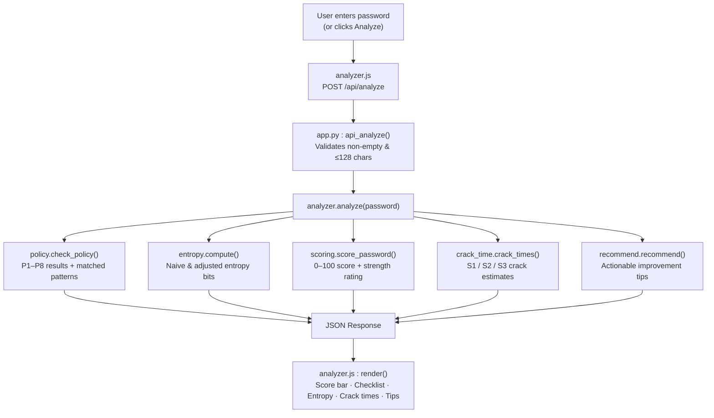
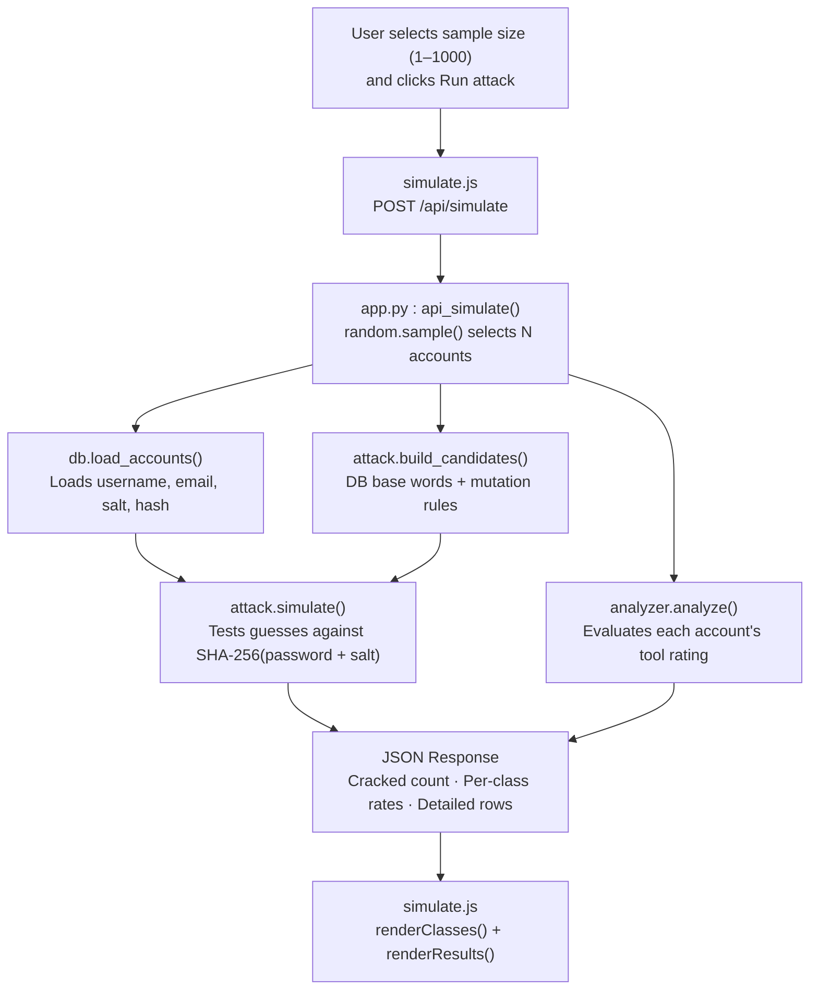

# 🛡️ PassAnalyzer

[](https://www.python.org/)
[](https://flask.palletsprojects.com/)
[](#)

A local **password-strength analyzer** and **dictionary-attack simulator** built with Python and Flask for a university security course. 

> 🔒 **Privacy & Local Execution:** All security logic resides in `core/`. The web interface only transmits inputs and displays results. The server binds strictly to `127.0.0.1`—passwords are never logged, written to disk, or passed in URLs.

---

## 🚀 Quick Start

### Prerequisites
* **Python 3.10+**

### Installation & Launch
```bash
python -m venv venv
venv\Scripts\activate          # Windows (macOS/Linux: source venv/bin/activate)
pip install -r requirements.txt
python app.py
```
Open **[http://127.0.0.1:5000](http://127.0.0.1:5000)** in your browser. There is no build step—the dictionary is generated in memory directly from the database on startup.

### Utility & Evaluation Commands
```bash
pytest                              # Run the 33 unit tests
python scripts/build_dictionary.py  # Print extracted base words and |W| for the report
python scripts/benchmark.py         # Measure hashes/second on the local machine
python scripts/run_evaluation.py    # Compute metrics M1–M7 and export to results/
```

---

## 🧠 How the Dictionary Works

Rather than relying on external wordlist files, the attacker's guess list is dynamically constructed **from the simulated database itself**:

1. **Base Word Extraction:** Every account's `username` and `email` begins with a base word (e.g., `jeddah_6635_0` / `jeddah_6635_0@example.com` $\rightarrow$ `jeddah`). `core.dictionary.base_words()` extracts these **28 base words** directly from the records (`jeddah`, `noura`, `hilal`, `qwerty`, `password`, etc.).
2. **Candidate Expansion:** `core.attack.build_candidates()` applies mutation rules (capitalization, leet substitutions, digit/year/symbol suffixes) to generate **~34,000 candidates** in memory without touching the disk.
3. **Salted Hash Verification:** Each candidate is tested against each account's salted hash (`SHA-256(password + salt)`).

---

## 📂 Project Structure

| Path | Description | Required to Run? |
| :--- | :--- | :---: |
| `app.py` | Flask application serving 2 web views and 2 JSON API endpoints | **Yes** |
| `core/` | Core cryptographic, policy, entropy, and attack simulation modules | **Yes** |
| `config/policy.json` | Centralized rules, weights, thresholds, and hash scheme settings | **Yes** |
| `templates/`, `static/` | Frontend HTML templates, stylesheets, and client-side JavaScript | **Yes** |
| `dictionary_attack_db.sql` | 1,000 simulated accounts serving as both targets and dictionary source | **Yes** |
| `scripts/` | CLI utilities for dictionary reporting, benchmarking, and evaluation | Optional |
| `tests/` | `pytest` test suite verifying Table 9 values, policy rules, and attacks | Testing |
| `PassAnalyzer_Build_Guide.md` | Course specification and build reference | Reference |
| `PassAnalyzer_Mid_Report2.docx` | Course midpoint documentation | Reference |
| `results/` | Generated evaluation metrics (`.json` / `.csv`) | Generated |

---

## ⚙️ Core Architecture (`core/`)

| Module | Responsibility |
| :--- | :--- |
| `db.py` | Parses simulated account records (`username`, `email`, `salt`, `hash`) from the SQL file |
| `dictionary.py` | Extracts base words from the database, performs leet-aware normalization, and detects dictionary matches |
| `mutations.py` | Generates password variants from base words (`Password`, `p@ssw0rd`, `riyadh2024`, etc.) |
| `policy.py` | Evaluates rules **P1–P8** (length, uppercase, lowercase, digit, symbol, dictionary word, keyboard walk, date/year) |
| `entropy.py` | Computes both **naive** entropy (uniform random characters) and **pattern-adjusted** entropy |
| `scoring.py` | Calculates the `0–100` strength score and maps it to 5 ratings (`Very Weak` $\rightarrow$ `Very Strong`) |
| `crack_time.py` | Estimates time-to-crack across attacker scenarios S1–S3 via $T = \frac{2^{H-1}}{R}$ |
| `recommend.py` | Produces targeted remediation advice for each failed policy rule |
| `attack.py` | Builds in-memory candidates from the DB, applies salts, hashes with SHA-256, and executes the attack |
| `analyzer.py` | Orchestrates the end-to-end analysis pipeline for a single password |

---

## 🔄 Application Workflows

### 1. Password Analyzer (`/`)



> **Pipeline Dependency:** `policy` executes first to detect dictionary words and keyboard walks. `entropy` consumes those matches to calculate *adjusted* bits, which then feed into both `scoring` and `crack_time`.

### 2. Attack Simulator (`/simulate`)



### UI-to-Backend Mapping

| UI Component | Backend Function | Source File |
| :--- | :--- | :--- |
| **P1–P8 Checklist** | `check_policy()` | `core/policy.py` |
| **Naive vs. Adjusted Entropy** | `compute()` | `core/entropy.py` |
| **Score & Strength Rating** | `score_password()` | `core/scoring.py` |
| **Crack-Time Table (S1–S3)** | `crack_times()` | `core/crack_time.py` |
| **Recommendations** | `recommend()` | `core/recommend.py` |
| **Dictionary & Guess List** | `base_words()` + `build_candidates()` | `core/dictionary.py`, `core/attack.py` |
| **Per-Class Crack Rates** | `simulate()` + `analyze()` | `core/attack.py`, `core/analyzer.py` |

---

## 📝 Technical Notes & Ethics

* **Hash Concatenation Order:** The database stores hashes computed as `SHA-256(password + salt)` (where `salt` is a short text string), verified directly against the dataset. While the build guide notes `salt + password`, the codebase matches the database by default and can be configured via `config/policy.json` $\rightarrow$ `attack.hash_scheme`.
* **Ethical Scope:** All simulated attacks run exclusively against synthetic hashes generated by Group 5 for simulated accounts. No real or leaked credentials are used.